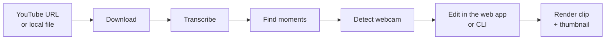

# gaming-clip

**Turn long gaming videos into vertical 1080x1920 shorts, on your own computer.**

[](LICENSE)
[](https://bun.sh)
[](#requirements)

Free and open source. If it saves you time, please support development:
[GitHub Sponsors](https://github.com/sponsors/iyansr) · [Tip via Yapp](https://yapp.ink/iyansr/tip) (IDR: QRIS, e-wallets, bank).

<!-- screenshot: docs/screenshot-editor.png -->

**Contents:** [What it does](#what-it-does) · [Requirements](#requirements) · [Quick start](#quick-start) · [Web app](#using-the-web-app) · [Settings](#settings-dialog) · [Highlight AI](#highlight-ai-options) · [CLI](#cli-reference) · [AI agent skill](#ai-agent-skill) · [Configuration](#configuration) · [Troubleshooting](#troubleshooting) · [Responsible use](#responsible-use) · [How it works](#how-it-works) · [Contributing](#contributing) · [License](#license)

## What it does

Paste a YouTube link or point at a recording. gaming-clip downloads it, writes a transcript, proposes the best
moments, finds your webcam overlay, and lets you polish each clip before rendering it as a short with captions and a cover image.



**Finding moments**

- Built-in heuristics: audio loudness spikes plus transcript cues (hype phrases, laughter, fast talking). No account, works offline.
- Or an AI picks them: an AI app you are signed in to (Claude Code, Codex CLI), or any OpenAI-compatible or Claude-compatible API.
- Clip count can be automatic: the engine decides how many moments are worth posting. Or ask for a number (1-60).

**Editing**

- Layouts: `split` (webcam on top, gameplay below), `fill` (gameplay cropped to 9:16), `fit` (whole frame over a blurred copy), `custom` (free-form boxes).
- Webcam: automatic detection, a visual editor to fix the rectangle, feathered edge, rounded corners or circle, border and border colour.
- Backgrounds for `custom`: blurred video, a colour, or your own image.
- Captions with word highlighting in 6 styles: `pop`, `neon`, `box`, `comic`, `clean`, `focus`. Per clip on or off.
- Per-clip trim, title and score. Manual clips next to the suggested ones.
- Thumbnails in 5 styles (`impact`, `banner`, `neon`, `comic`, `minimal`) with an automatic best-frame pick and a headline you can edit (`*word*` colours a word).
- The live preview is drawn by the same code as the final render, so what you see is what you get.

**Speed**

- On Apple Silicon, transcription runs on the GPU through Metal.
- Long audio is transcribed in chunks cut at pauses; finished chunks are cached, so an interrupted run resumes instead of starting over.
- Several clips render at the same time (default 2, up to 4).

**Agent friendly**

- Every action in the web app also exists in the `clip` CLI, with `--json` output.
- A ready-made Claude Code skill (`.claude/skills/gaming-clip`) lets an AI agent drive the whole workflow.

## Requirements

|               | macOS                                                                         | Windows                                                                               |
| ------------- | ----------------------------------------------------------------------------- | ------------------------------------------------------------------------------------- |
| Version       | macOS 13 or newer recommended                                                 | Windows 10 (1803+) or 11, 64-bit                                                      |
| CPU           | Apple Silicon recommended; Intel works                                        | x64                                                                                   |
| Bun 1.2+      | `curl -fsSL https://bun.sh/install \| bash` or `brew install oven-sh/bun/bun` | `powershell -c "irm bun.sh/install.ps1 \| iex"`                                       |
| Git           | `xcode-select --install` or `brew install git`                                | [git-scm.com](https://git-scm.com/download/win) (or download the repository as a ZIP) |
| Tools         | ffmpeg, yt-dlp, whisper.cpp: installed for you by `bun run setup`             | the same, downloaded into the `tools/` folder by `bun run setup`                      |
| Transcription | GPU (Metal) on Apple Silicon                                                  | CPU only: slower, especially for hours of video                                       |

Disk space: about 1 GB for the speech model (default 575 MB), the face model and the tools, plus room for your videos and renders.
Bigger speech models need more (the largest is about 3 GB).

Linux is not a supported target: `bun run setup` cannot download tools there. You would have to install ffmpeg, yt-dlp and whisper-cli yourself.

## Quick start

```bash
git clone https://github.com/iyansr/gaming-clip.git
cd gaming-clip
bun install
bun run setup
bun run start
```

Open **http://localhost:4321**.

`bun run setup` checks what is missing and installs it. Running it again is safe: it only fetches what is not there.

| Platform                               | What it installs                                                                                                                                  |
| -------------------------------------- | ------------------------------------------------------------------------------------------------------------------------------------------------- |
| macOS with [Homebrew](https://brew.sh) | `brew install` for the missing tools among `ffmpeg`, `yt-dlp` and `whisper-cpp`                                                                   |
| macOS without Homebrew                 | ffmpeg (LGPL build) and yt-dlp downloaded into `tools/`. whisper.cpp has no macOS download: install Homebrew, then run `brew install whisper-cpp` |
| Windows                                | ffmpeg (LGPL build, about 175 MB), yt-dlp (about 24 MB) and whisper.cpp (CPU build, about 9 MB), downloaded and checksum-verified into `tools/`   |
| All                                    | the speech model `ggml-large-v3-turbo-q5_0.bin` (about 575 MB) and the YuNet face model (0.2 MB) into `models/`                                   |

Tools in `tools/` are used before the ones on your `PATH`. Run `bun run clip doctor` at any time to see what is installed.

## Using the web app

<!-- screenshot: docs/screenshot-editor.png -->

1. **Create a project.** On the home page paste one or more YouTube video URLs, or full paths to local files (one per line, for example `/Users/me/Videos/stream.mp4` or `C:\Videos\stream.mp4`). Playlist and channel URLs are not supported: paste single videos.
2. **Choose the basics.** Language (or Auto), how many clips to find (tick **Auto** to let the engine decide), and the minimum and maximum clip length in seconds. Click **Create project**.
3. **Watch the stages.** Download, transcribe, highlights and webcam run one after another with progress on the project card. If a stage fails, the error shows on the card and **Retry** resumes at the first unfinished stage.
4. **Open the project.** The editor appears as soon as the download is done. Tick the clips you want in the list. Each has a title, a score and a reason.
5. **Trim.** Set the start and end of a clip (type a time or use the player). Add your own clip if the engine missed a moment.
6. **Pick a layout.** `split`, `fill`, `fit` or `custom`. For `custom`, drag and resize the gameplay and webcam boxes right on the preview, crop what each shows, and choose the background.
7. **Pick captions.** Choose a style from the gallery, switch captions off for clips without speech, move the captions up or down.
8. **Fix the webcam if needed.** Open the webcam editor and drag the rectangle over your facecam, or mark that the video has none (`split` then falls back to `fill`).
9. **Make a thumbnail.** Switch the preview to **Thumbnail**: pick a frame (suggested sharp frames near loud moments, the playhead, or a scrubber), edit the headline, choose a style and position.
10. **Render.** Click **Render N selected**. Clips render a couple at a time; **Cancel render** stops them. Each finished clip can be played and downloaded in the page.

Everything lands in `workspace/projects/<id>/clips/` (use the `GCLIP_WORKSPACE` variable to move the workspace):

```text
workspace/projects/<id>/
  project.json                  all state of the project: stages, clips, settings
  source.mp4                    the downloaded (or converted) video
  transcript.json               timed words
  clips/<clipId>-<title>.mp4    the short: 1080x1920, H.264 + AAC
  clips/<clipId>-<title>.jpg    its cover image, 1080x1920
```

## Settings dialog

Click the gear icon at the top right of any page. No `.env` file is needed.

| Section           | What it does                                                                                                                                                                                                                                                        |
| ----------------- | ------------------------------------------------------------------------------------------------------------------------------------------------------------------------------------------------------------------------------------------------------------------- |
| **Highlight AI**  | Off (built-in method), an AI app on this computer (Claude Code or Codex), or an OpenAI-compatible or Claude-compatible service: model name, optional web address, API key. **Test** sends one tiny real request. See [Highlight AI options](#highlight-ai-options). |
| **Transcription** | The speech model, with sizes: models download from inside the dialog. The default language for new projects.                                                                                                                                                        |
| **Rendering**     | How many clips render at the same time (1 to 4). More is faster on a strong computer but uses more memory.                                                                                                                                                          |
| **About**         | Version, address, the projects and models folders, links to the source and to support the project.                                                                                                                                                                  |

- Settings are saved in `<workspace>/settings.json` with file mode `0600` (it can hold an API key). The key stays on your computer and is never sent back to the browser.
- Changes apply without a restart, to renders and projects started afterwards.
- A value set by an environment variable or in `.env` wins over the dialog. The field shows as locked, for example "Set by `LLM_MODEL` in .env".
- The dialog only offers the built-in app presets. An arbitrary command is possible only through `LLM_COMMAND` in your environment.

## Highlight AI options

|                     | Off (default)                                                      | Claude Code or Codex CLI                                               | OpenAI-compatible API                                                          | Claude-compatible API                                  |
| ------------------- | ------------------------------------------------------------------ | ---------------------------------------------------------------------- | ------------------------------------------------------------------------------ | ------------------------------------------------------ |
| **Where to set it** | Settings                                                           | Settings (preset)                                                      | Settings or `.env`                                                             | Settings or `.env`                                     |
| **Cost**            | Free                                                               | No API key: uses the plan of the app you are signed in to              | Pay per token with a hosted service; free when run locally (Ollama, LM Studio) | Pay per token (Anthropic or a gateway)                 |
| **Setup**           | None                                                               | Install the app and sign in once                                       | Model name, API key, optional base URL (ending in `/v1`)                       | Model name, API key, optional base URL (without `/v1`) |
| **Quality**         | Good for loud, reactive moments. Does not understand what happens. | Understands the story; slower because each run starts an agent session | Depends on the model. Small local models are weaker                            | Depends on the model                                   |
| **Privacy**         | Nothing leaves your computer                                       | The transcript goes to that service                                    | The transcript goes to the provider (stays local with a local server)          | The transcript goes to the provider                    |

If the AI call fails, the project falls back to the built-in method and shows a warning. The Claude Code preset runs `claude -p --tools ""` and the Codex preset runs `codex exec --skip-git-repo-check --sandbox read-only --ephemeral -`.

API access goes through [Anvia](https://anvia.dev). Examples for `.env`:

```bash
# Ollama on this computer
LLM_PROVIDER=openai
LLM_BASE_URL=http://localhost:11434/v1
LLM_MODEL=llama3.1

# Anthropic
LLM_PROVIDER=anthropic
LLM_API_KEY=sk-ant-...
LLM_MODEL=<a Claude model id>
```

## CLI reference

Everything the web app does is available from the terminal and works on the same projects: changes made by the CLI show up live in an open browser tab.
Run `bun run clip` for the full list. Add `--json` to any command for machine-readable output (progress goes to stderr).
Exit codes: `0` ok, `1` failure, `2` usage error. Times are seconds (`83.5`) or `MM:SS(.s)` / `H:MM:SS(.s)`.

**Setup and server**

| Command                 | Purpose                                                         |
| ----------------------- | --------------------------------------------------------------- |
| `clip doctor`           | Dependency table; exit 1 if anything is missing                 |
| `clip setup`            | Download missing tools (ffmpeg, yt-dlp, whisper-cli) and models |
| `clip serve [--port N]` | Start the web app                                               |
| `clip version`          | Version, platform and support links                             |

**Create and run projects**

| Command                                                                                           | Purpose                                                                                                                                                                        |
| ------------------------------------------------------------------------------------------------- | ------------------------------------------------------------------------------------------------------------------------------------------------------------------------------ |
| `clip new <url\|file>... [--lang auto] [--clips auto\|N] [--min 20] [--max 60] [--no-highlights]` | Create projects and run the pipeline to the end. `--no-highlights` skips picking moments                                                                                       |
| `clip rerun <id> [--from <stage>] [--clips auto\|N] [--min S] [--max S] [--no-highlights]`        | Run again. Without `--from` it resumes at the first unfinished stage. Stages: `download`, `transcribe`, `highlights`, `webcam`. Rerunning highlights replaces non-manual clips |
| `clip list`                                                                                       | Projects: id, title, duration, stage status, clip counts                                                                                                                       |
| `clip rm <id>`                                                                                    | Delete the project and its files                                                                                                                                               |

**Inspect**

| Command                                         | Purpose                                                                          |
| ----------------------------------------------- | -------------------------------------------------------------------------------- |
| `clip show <id>`                                | Stages, webcam, warnings, clips table                                            |
| `clip transcript <id> [--from T] [--to T]`      | Timed transcript with loudness marks; with `--json` the transcript for the range |
| `clip frame <id> <T> <out.jpg> [--crop webcam]` | Write the frame at time `T`, optionally cropped to the webcam                    |

**Clips and look**

| Command                                                                                                                                                                     | Purpose                                                                           |
| --------------------------------------------------------------------------------------------------------------------------------------------------------------------------- | --------------------------------------------------------------------------------- |
| `clip clips set <id> <file.json>`                                                                                                                                           | Replace all non-manual clips with picks from `[{start,end,title,reason?,score?}]` |
| `clip clips add <id> <start> <end> [title]`                                                                                                                                 | Add a manual clip                                                                 |
| `clip clips rm <id> <clipId>`                                                                                                                                               | Remove a clip                                                                     |
| `clip clips select <id> <clipId,...\|all\|none>`                                                                                                                            | Choose which clips render                                                         |
| `clip webcam <id> [--detect \| --none \| --rect x,y,w,h]`                                                                                                                   | Detect again, mark "no webcam", or set the rectangle in source pixels             |
| `clip settings <id> [--clips a,b\|all] [--layout split\|fill\|fit\|custom] [--custom-json <file>] [--subtitles on\|off] [--style <id>] [--caption-y 0..1] [--focus-x 0..1]` | Layout and caption settings. Without `--clips` it changes the project defaults    |

**Output**

| Command                                                                                                                            | Purpose                                                         |
| ---------------------------------------------------------------------------------------------------------------------------------- | --------------------------------------------------------------- |
| `clip render <id> [--clips a,b\|all]`                                                                                              | Render the selected clips one after another and print the files |
| `clip thumbnail <id> [--clips a,b\|all] [--time T\|auto] [--text "..."] [--no-text] [--title-text] [--style <id>] [--text-y 0..1]` | Make 1080x1920 cover images and print the files                 |

`bun run clip` is the same as `bun src/cli.ts`; the `clip` in the tables stands for either.

### Worked examples

**1. Fully automatic, from a link to files**

```bash
bun run clip new "https://www.youtube.com/watch?v=VIDEO_ID" --clips auto
bun run clip list                      # find the project id
bun run clip settings <id> --clips all --layout split --style neon
bun run clip clips select <id> all
bun run clip render <id>               # prints the mp4 files
```

**2. Pick your own moments**

```bash
bun run clip new "C:\Videos\stream.mp4" --no-highlights     # macOS: "/Users/me/Videos/stream.mp4"
bun run clip transcript <id> --from 10:00 --to 20:00        # read a window of the transcript
bun run clip clips add <id> 12:31 12:58 "He never saw it coming"
bun run clip webcam <id> --rect 1500,0,420,236              # fix the facecam if detection missed it
bun run clip render <id> --clips all
```

**3. Cover image with a custom headline**

```bash
bun run clip thumbnail <id> --clips <clipId> --text "HE WAS *RIGHT BEHIND* ME" --style comic --time 2:41
```

## AI agent skill

`.claude/skills/gaming-clip/SKILL.md` teaches an AI agent how to use the CLI: ingest a video, read the transcript, choose the moments itself, check the webcam rectangle, apply layouts and captions, render, and review the result.

With [Claude Code](https://claude.com/claude-code):

1. Open Claude Code in the gaming-clip folder. It finds the skill by itself.
2. Ask in plain words: _"Make 5 shorts from https://www.youtube.com/watch?v=VIDEO_ID"_ or _"Clip the funniest moments of this recording and let me review them in the editor."_
3. The agent runs `bun run clip ...`, then hands you the editor URL (`http://localhost:4321/project/<id>`) so you can fine-tune before rendering.

Other agents can follow the same file: it is plain Markdown that lists the commands and the judgement rules for good gaming shorts.

## Configuration

Everything is optional. Copy `.env.example` to `.env` to set values (Bun loads it automatically), or set real environment variables.
A value set here wins over the Settings dialog.

| Variable                    | Default                                                                  | Meaning                                                                                                                                                                                               |
| --------------------------- | ------------------------------------------------------------------------ | ----------------------------------------------------------------------------------------------------------------------------------------------------------------------------------------------------- |
| `PORT`                      | `4321`                                                                   | Web app port                                                                                                                                                                                          |
| `HOST`                      | `127.0.0.1`                                                              | Bind address. The default allows this computer only. `0.0.0.0` exposes the app, your media and local-file input to the whole network: use it only on a network you trust                              |
| `WHISPER_MODEL`             | `large-v3-turbo-q5_0`                                                    | whisper.cpp model name, file `models/ggml-<name>.bin`. Run `bun run setup` after changing it, or download it from Settings                                                                            |
| `GCLIP_RENDER_JOBS`         | `2`                                                                      | Clips rendered at once (1 to 4). Download and transcription still run one at a time                                                                                                                   |
| `LLM_COMMAND`               | unset                                                                    | Highlight AI through any command-line AI you are signed in to. The prompt goes to stdin, stdout must be the JSON answer, for example `claude -p --tools ""`. Wins over `LLM_MODEL`                    |
| `LLM_PROVIDER`              | `openai`                                                                 | `openai` (Chat Completions) or `anthropic` (Messages)                                                                                                                                                 |
| `LLM_MODEL`                 | unset                                                                    | Model name. Unset means built-in heuristics (unless `LLM_COMMAND` is set)                                                                                                                             |
| `LLM_BASE_URL`              | provider's own API                                                       | API address. `openai`: include `/v1`. `anthropic`: without `/v1`                                                                                                                                      |
| `LLM_API_KEY`               | unset                                                                    | API key. Local servers can leave it empty                                                                                                                                                             |
| `GCLIP_WORKSPACE`           | `workspace`                                                              | Projects and `settings.json` live here                                                                                                                                                                |
| `GCLIP_MODELS`              | `models`                                                                 | Model files live here                                                                                                                                                                                 |
| `FFMPEG_BIN`, `FFPROBE_BIN` | `tools/ffmpeg/bin/<name>` if present, else `ffmpeg`, `ffprobe` on `PATH` | Use a specific ffmpeg or ffprobe                                                                                                                                                                      |
| `YT_DLP_BIN`                | `tools/yt-dlp` if present, else `yt-dlp` on `PATH`                       | Use a specific yt-dlp                                                                                                                                                                                 |
| `WHISPER_BIN`               | `tools/whisper/whisper-cli` if present, else `whisper-cli` on `PATH`     | Use a specific whisper.cpp CLI                                                                                                                                                                        |
| `GCLIP_VIDEO_ENCODER`       | automatic                                                                | Force the H.264 encoder: `libx264`, `h264_videotoolbox` (macOS), `libopenh264` or `h264_mf` (Windows). Automatic means `libx264` when your ffmpeg has it, otherwise the first platform encoder it has |
| `GCLIP_WHISPER_MODEL_URL`   | Hugging Face                                                             | Download the speech model from another URL (an `https://` mirror or a `file://` path), for offline installs                                                                                           |

On Windows the tool paths get a `.exe` suffix automatically.

## Troubleshooting

**Check your install first.** `bun run clip doctor` lists ffmpeg, ffprobe, yt-dlp, whisper-cli and the two model files, and prints the fix for anything missing. The web home page shows the same warning.

**"ffmpeg has no H.264 encoder", or ffmpeg without libx264.** `doctor` shows the encoder in use, e.g. `[H.264: h264_mf]`. LGPL ffmpeg builds (the ones `setup` downloads on Windows) have no libx264, so gaming-clip uses the platform encoder instead: VideoToolbox on macOS, OpenH264 or Media Foundation on Windows. Force one with `GCLIP_VIDEO_ENCODER`. Those encoders use a fixed bitrate (12 Mbit/s), so files can be several times larger than libx264 at similar quality. If your ffmpeg has no H.264 encoder at all, run `bun run setup` or point `FFMPEG_BIN` at a full build.

**Transcription is slow on Windows.** whisper.cpp runs on the CPU there. Pick a smaller speech model in Settings, for example `small-q5_1` or `base-q5_1`: less accurate, much faster. Longer videos still work because audio is transcribed in chunks.

**The webcam is not detected, or the wrong area is used.** Open the webcam editor in the project and drag the rectangle over the facecam. From the terminal: `bun run clip webcam <id> --rect x,y,w,h` (source pixels), `--none` if there is no facecam, `--detect` to run detection again. Check the result with `bun run clip frame <id> 120 cam.jpg --crop webcam`.

**Port 4321 is in use.** Set `PORT` in `.env` (for example `PORT=4400`), or run `bun run clip serve --port 4400`.

**A long video was interrupted.** Click **Retry** in the web app, or run `bun run clip rerun <id>`. It resumes at the first unfinished stage, and transcription reuses every finished chunk. `--from <stage>` forces a stage and everything after it to run again.

**macOS: `bun run setup` says whisper-cli cannot be downloaded.** whisper.cpp has no macOS download. Install [Homebrew](https://brew.sh) and run `bun run setup` again.

**yt-dlp cannot download a video.** Sites change often. Update yt-dlp: `brew upgrade yt-dlp` if Homebrew installed it, otherwise delete `tools/yt-dlp` (`tools\yt-dlp.exe` on Windows) and run `bun run setup`. Or download the video yourself and give its file path.

Still stuck? [Open an issue](https://github.com/iyansr/gaming-clip/issues) with the output of `bun run clip doctor` and `bun run clip version`.

## Responsible use

Only clip content you own or have permission to use: your own streams and recordings, or videos whose creators allowed it.
Downloading from YouTube may violate its Terms of Service. You are responsible for how you use this tool and for what you publish.
gaming-clip does not host, distribute or index any content: everything happens on your computer.

## How it works

- **Shared drawing code.** Layouts, caption drawing and the webcam mask (feather, radius, border) live in `src/shared`. The browser preview, the final render and the thumbnails all call the same functions, so the preview matches the output. Captions are drawn with `@napi-rs/canvas` and composited by ffmpeg, so ffmpeg does not need libass or freetype.
- **`project.json` store.** Each project is a folder with one `project.json`. The CLI, the server and the web app read and write it through a lock that works across processes, so they can be used at the same time.
- **Job queue.** The server runs one pipeline job at a time (download, transcribe, highlights, webcam) and renders clips in parallel up to the render-jobs setting. Progress streams to the browser as server-sent events.
- **Webcam detection.** A YuNet face detector (ONNX) plus a search for the static overlay border, over sampled frames.

### Code layout

```text
src/
  cli.ts          the clip CLI
  shared/         types, layout geometry, caption and thumbnail styles, webcam mask; used by browser and renderer
  core/           download, transcribe, audio, highlights, llm, webcam, frames, render, thumbnail,
                  store, pipeline, jobs, settings, encoder, doctor, setup
  server/         Bun.serve HTTP API, server-sent events, media
  web/            React + Tailwind web app
scripts/setup.ts  entry of `bun run setup`
tests/            bun test
assets/fonts/     bundled caption fonts (OFL)
.claude/skills/   the Claude Code skill
tools/            tools downloaded by setup (created on demand, git-ignored)
models/           speech and face models (created by setup, git-ignored)
workspace/        your projects and settings.json (git-ignored)
```

### Development

```bash
bun run dev           # server with hot reload
bun run check         # typecheck + lint + format check + tests: run before opening a PR
bun run typecheck     # tsc --noEmit
bun run lint          # oxlint (type-aware); lint:fix repairs what it can
bun run format        # oxfmt; format:check only reports
bun test              # tests
```

The tests use the built-in heuristics only and do not call any AI.

## Contributing

Issues and pull requests are welcome. Please run `bun run check` before you open a PR, and keep a change focused on one thing.
For a bigger change, open an issue first so we can agree on the approach.

## License

[AGPL-3.0](LICENSE): you can use, study, change and share gaming-clip freely. If you distribute a modified version, or let others use it over a network, you must offer them the source of your version under the same licence.
Your videos and the clips you make are yours: the licence covers the software, not its output.

### Credits and third-party software

Full list with links in [THIRD_PARTY_NOTICES.md](THIRD_PARTY_NOTICES.md).

- [whisper.cpp](https://github.com/ggml-org/whisper.cpp) (MIT) for speech to text
- [YuNet](https://github.com/opencv/opencv_zoo/tree/main/models/face_detection_yunet) (MIT) for face detection
- [FFmpeg](https://ffmpeg.org) (LGPL or GPL, depending on the build you use) for video processing
- [yt-dlp](https://github.com/yt-dlp/yt-dlp) (Unlicense) for downloading
- Fonts Anton, Bangers and Poppins (SIL OFL 1.1), bundled in `assets/fonts` with their licence texts
- [Anvia](https://anvia.dev) (MIT) for the AI API clients

## Support

gaming-clip is free. If it helps your channel, you can support it:
[GitHub Sponsors](https://github.com/sponsors/iyansr) · [Tip via Yapp](https://yapp.ink/iyansr/tip).
Bugs and ideas: [GitHub issues](https://github.com/iyansr/gaming-clip/issues).
